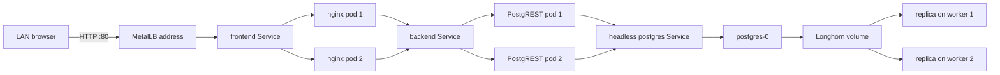

# Architecture and Design Decisions

## Request and storage path

## Cluster topology

| Node | Main role | Application scheduling |
|---|---|---|
| `k8s-control` | API server, etcd, scheduler, controllers | Normal workloads remain off by default |
| `k8s-worker1` | Application and Longhorn storage | Yes |
| `k8s-worker2` | Application and Longhorn storage | Yes |

Calico supplies pod-to-pod networking across nodes. MetalLB layer-2 mode lets a
`LoadBalancer` Service receive a usable address on the local network.

## Workload choices

### PostgreSQL StatefulSet

The database needs a stable pod identity and persistent data, so it is a
single-replica StatefulSet backed by a `ReadWriteOnce` claim. The Longhorn
volume stores two copies on separate workers. This protects against one worker
disk or node becoming unavailable, but PostgreSQL still has a short restart
period because only one database pod is active.

### PostgREST Deployment

Two stateless API replicas expose only the `api` schema. Anonymous requests run
as the read-only `web_anon` database role. The Service distributes requests and
Kubernetes replaces failed pods.

### nginx Deployment

Two stateless nginx replicas serve the interface and reverse-proxy `/api/` to
PostgREST. The container listens on unprivileged port 8080 and uses a read-only
root filesystem plus temporary writable volumes.

## Resilience controls

- Two frontend and two backend replicas.
- Rolling updates with zero planned unavailable replicas.
- Readiness and liveness probes on all workloads.
- Topology spread preferences across hostnames.
- PodDisruptionBudgets for frontend and backend.
- Two Longhorn data replicas across workers.
- Fixed CPU and memory requests and limits.

PodDisruptionBudgets protect voluntary disruptions; they cannot prevent an
unexpected node failure. `ScheduleAnyway` is used for topology spreading so a
single surviving worker can host both replicas during recovery.

## Security controls

- Default-deny ingress and egress inside the `fullstack` namespace.
- Explicit frontend-to-backend and backend-to-database paths only.
- DNS egress explicitly allowed.
- No database port exposed outside the namespace.
- Read-only anonymous database role.
- Dropped Linux capabilities and disabled privilege escalation.
- Runtime-default seccomp profiles.
- Database password created interactively and excluded from Git.

Remaining lab limitations include unencrypted HTTP, one control-plane node,
base64 Kubernetes Secrets, no external identity provider, and no independent
backup target.

